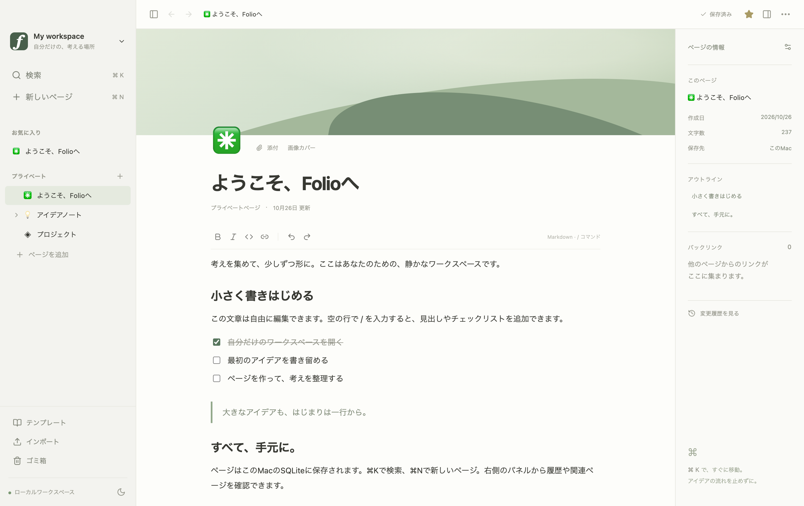

# Folio

ローカルで書き、ページを整理する、独立したElectronデスクトップアプリ。
Notionのコード・ロゴ・イラストを使用していません。Notionとの提携はありません。

> 現段階は実際に利用できる開発版です。依頼全体の完成、Notionとの完全互換、内部解析完了を意味しません。検証範囲と未完成機能は [FEATURES.md](FEATURES.md) を参照してください。

外部レビューは [レビューガイド](docs/REVIEW-GUIDE.md) から始めてください。[既知の問題](docs/KNOWN-ISSUES.md)、[共有前検査](docs/SHARING-AUDIT.md)、[画面一覧](docs/screenshots/README.md) も用意しています。



## R6：保存・DB構成・復旧（2026-10-28）

新DBの行をページとして編集し、本文・タイトル・プロパティ・ビュー設定を保存できます。旧DBは対象を選択し、コピー検証とプレビュー後に移行します。列は5型の追加・名前変更・変換可能な型変更に対応しています。

復旧用保存の完了後は、強制終了しても再起動時に保存結果と未保存入力を照合できます。競合した原本を変更せず別ページへ復旧する経路もあります。詳しくは [R6公開チェックポイント](docs/R6-CHECKPOINT.md) を参照してください。

固定版でビルド・型チェック、単体 **572/572**、全E2E **156/156**（実Electron128＋ブラウザー部品28）が成功しています。これは合成データでの確認であり、実データの移行・本番反映・電源断時の完全復旧を完了した記録ではありません。

## 起動

macOS Apple Silicon / Node.js **24.20.0** で開発・検証。レビュー準備時のnpmは **11.19.0**。実際の依存バージョンはlockfileに固定しています。Windows・Linux・Intel Macでの動作確認は未実施です。以下はリポジトリのルートで実行してください。

```sh
npm ci
npm run setup         # Electronバイナリが未取得の場合のみ取得
npm run build
npm start
```

開発時は `npm run dev`。ビルド済みアプリは `release/Folio-darwin-arm64/Folio.app`。
`.app` はGitに含めず、`npm run package` で生成します。開発者による配布署名・公証はしていません。このフォルダ内で起動する開発用成果物です。

```sh
npm test              # SQLite・階層・編集・データベースの単体テスト
npm run test:e2e      # 実Electronの操作・保存・再起動テスト（先にbuild）
npm run check        # TypeScript strict
npm run package      # macOS arm64アプリを作成
```

依存の取得にはネット接続が必要です。REA、Notionのインストール・ログイン、APIキーはFolioの起動・テストには不要です。SQLiteはNode/Electron内蔵の `node:sqlite` を使用します。`npm run dev` はローカルポート5173を使います。

`npm run build` → `npm run test:e2e` の順で実行してください。E2EはElectronを起動するため、macOSのGUIセッションが必要です。部品テスト用にPlaywright Chromiumも必要です。未取得なら `npx playwright install chromium` を実行してください。開発起動・パッケージ起動の追加確認は、それぞれ `node scripts/verify-dev.mjs`、`node scripts/verify-package.mjs`（先にpackage）です。

E2Eテストは専用データを作成し、終了時にそのデータのみ削除します。クリップボードテストは一時的にサンプルを書き込み、テスト開始時の内容を復元します。実行中に他のアプリでコピーしないでください。最初の開発試行で復元APIの差異による失敗があったことは進捗記録に残しています。

## 基本操作

- 左側でページ作成・展開。ページを別ページにドロップすると入れ子、行の上端へドロップするとその前へ移動。最下部「ページを追加」へドロップすると最上位へ。
- `⌘N` 新規、`⌘K / ⌘P` 全文検索、`⌘F` ページ内検索、`⌘\\` サイドバー、`⌘⇧L` テーマ、`⌘[ / ⌘]` 戻る・進む。
- 本文で `/` → 矢印キーとEnterでブロック選択。`# ` 見出し、`- ` 箇条書き、`[] ` To-do、`> ` トグル、`| ` 引用。`⌘B` 太字、`⌘I` 斜体。
- 本文左のハンドルでブロック選択、Shiftクリックで範囲選択、ドラッグで並べ替え。選択後のボタンで上下移動・複製・削除。Undo/Redo対応。
- ページメニューから複製・移動・ゴミ箱・書き出し・履歴・バックアップ。
- テンプレートまたは検索パレットからデータベース作成。行・プロパティを編集し、表・ボード・カレンダー・ギャラリーで表示。
- リンクボタンから別ページへリンクすると、リンク先にバックリンクが表示されます。

## データ

既定の保存先はElectronのユーザー領域にある `~/Library/Application Support/Folio/workspace/` です。開発起動・パッケージ起動で共通になり、アプリを移動しても変わりません。SQLiteは `workspace.sqlite`、添付は `assets/` に保存します。
`FOLIO_DATA_DIR=/absolute/path npm start` で明示的に切り替えられます。テスト・別開発用には専用フォルダを指定してください。

旧 `.folio-data` / `release/.folio-data` は自動削除しません。新しい保存先が未作成で旧データを検出した初回起動では、コピー・別フォルダ選択・新規開始・終了を選べます。移行とロールバックの詳細は [Gate A対応記録](docs/AUDIT-RESPONSE.md)。任意の旧データを移行する場合は、旧アプリを終了し、次を実行します。

```sh
node scripts/migrate-workspace.mjs --source /path/to/old-data --destination /path/to/new-data
FOLIO_DATA_DIR=/path/to/new-data npm start
```

移行先は未作成のフォルダを指定します。移行元を保持し、移行先の隣にSQLite＋assetsのバックアップを作成してからコピーします。既存の移行先を上書きしません。

保存表示が「保存済み」になってから終了してください。保存待ちがある場合はウィンドウの終了を止めます。保存失敗は赤い通知に表示されます。失敗した変更はメモリに保持され、保存の再試行ができます。「退避して再読込」は未保存パッチ・画面の内容・保存済みデータをJSONに書き出せた場合だけ保存済みデータへ戻ります。ページメニューの「退避JSONから復旧」は同じワークスペース内に `[復旧]` ページを作り、元のページも保持します。この形式は添付同梱のポータブル形式ではありません。R6では復旧用ジャーナルを追加しました。復旧用保存済みの入力と操作IDを保持し、再起動時の明示操作で照合・復旧します。保存応答前の入力、未送信の作成・列設定フォーム、電源断時の完全復旧は保証対象外です。

「ワークスペースをバックアップ」はSQLiteスナップショットとassetsを `backups/workspace-<timestamp>/` に保存します。復元はアプリを終了し、現在のデータフォルダを別名で退避してから、スナップショットの `workspace.sqlite` と `assets` をデータフォルダへコピーしてください。古い `workspace.sqlite-wal` / `-shm` と混在させないでください。UIからの全体復元は未実装です。

DBの操作は「DB変更を元に戻す」ボタンで取り消せます。再起動後は「変更履歴」から削除前の行・プロパティ・タイトル・本文を復元できます。履歴はページごとに直近100件です。従来版の本文履歴にはDBの状態が含まれないため、古い履歴の復元では現在のDBを維持します。

文書のschemaVersionや構造が未対応の場合は編集を停止し、原本JSONの書き出しを表示します。JSON自体が壊れていてページを開けない場合はエラー画面からバックアップできます。空の文書で自動上書きしません。

## 調査と引き継ぎ

- [仕様](docs/SPEC.md) / [構成と判断](docs/ARCHITECTURE.md)
- [機能一覧・未完成](FEATURES.md)
- [検証結果](docs/TEST-RESULTS.md)
- [REA Evidenceレポートと選択・匿名化証拠](docs/rea/README.md)
- [REA接続方法](docs/MCP-CONNECTION.md)
- [現在地・次の作業](docs/PROGRESS.md)

REAは `tools/rea/` に隔離してあります。アプリの起動には不要です。CodexのグローバルMCP設定は変更していません。

## 外部レビュー用の構成

```text
README.md / FEATURES.md       起動手順・機能状態
src/                         main / preload / renderer / editor / persistence / database
tests/                       単体・Electron操作・共有検査のテスト
docs/                        仕様・設計・既知の問題・レビューガイド
docs/rea/                    REAの共有用証拠（原本由来と制約を明示）
docs/validation/             匿名化ログ・性能記録・検証manifest
docs/screenshots/            Folioのサンプル画面のみ
research/                    研究過程の記録。evidence原本はローカルのみ
tools/rea/                   固定版REAを使うMCPクライアント
scripts/                     build / package / review
```

```sh
npm run review:test           # 共有検査の5テスト
npm run review:scan           # 現在の共有候補と到達可能なGit履歴を検査
npm run review:export         # 履歴を含まないoutput/review/folio-review.tar.gz
```

これらは外部サービスへ送信しません。`review:scan` の終了コードは現在の共有候補の検出有無を表し、Git履歴の所見は別途JSONに記録します。過去コミットのパス・HTML・作者メタデータは残っているため、既存リポジトリの公開範囲を広げる前に [共有前検査](docs/SHARING-AUDIT.md) を確認してください。

共有検査にはGit、アーカイブ生成にはtarを使います。`review:scan` / `review:export` はコミット履歴のあるGit作業ツリー向けです。履歴なしアーカイブの受領者は、通常の `npm ci` 以降の起動・ビルド・アプリテストをそのまま実行できます。

本体の公開ライセンスはまだ選択していません。第三者ライセンス表記は [THIRD_PARTY_NOTICES](docs/THIRD_PARTY_NOTICES.txt)、REAのライセンスは [LICENSE-REA](tools/rea/LICENSE-REA.txt) にあります。
