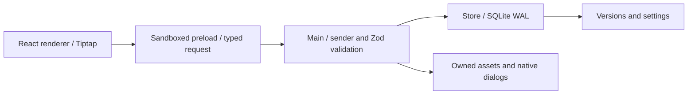

# アーキテクチャ

## モジュール

- `src/main/index.ts`: Electronライフサイクル、ネイティブダイアログ、IPC送信元検査、添付プロトコル、バックアップ。
- `src/preload/index.ts`: contextBridge。任意チャンネル・fs・Node APIを公開しない。
- `src/shared/types.ts`: discriminated unionの要求型、実行時入力検証、保存モデル。
- `src/persistence/store.ts`: migration、トランザクション、階層不変条件、楽観的ロック、検索、履歴。Electron非依存でテスト。
- `src/renderer/App.tsx`: ツリー・ページ遷移・保存キュー・各ダイアログ。将来、保存キューとツリーをhook/componentに切り出す余地がある。
- `src/editor/`: Tiptap拡張、ブロック操作の純粋関数、スラッシュUI。
- `src/database/`: 行のfilter/sort/calendar計算と4ビュー。

## 判断

### Tiptap対ProseMirror直接利用

ProseMirrorはスキーマ、Transaction、Selection、履歴の細かな制御が可能。Tiptapはその上にReact統合と標準ブロック群を提供する。今回の優先事項は実際に使える編集機能を早く検証しつつ独自UIを持つことなのでTiptap 3を採用。ブロックの移動はProseMirrorのTransactionとして適用し、Undo履歴と統合する。NotionがTiptapを使用するという推定ではない。

### SQLite

Electron 45のNode組み込みSQLiteを使い、ネイティブ拡張のABI再ビルドを避ける。起動時user_versionを確認。version 1にはpages、settings、versionsを作成。未知の将来バージョンは開かない。WAL + synchronous FULL、階層変更のトランザクション、prepared statements、revision不一致の拒否を採用。DB処理はMainで同期実行するため、大規模化時はworker/utility processへ分離する。

### 文書と同期の境界

本文はProseMirror JSONとしてページ単位に保存。ブロックごとの永続ID、CRDT、操作ログはない。したがって同期・共同編集へそのまま移行できるとは主張しない。将来は文書schema version、stable block ID、添付参照テーブル、変更ログのmigrationを先に追加し、その後Yjsなどを比較する。

### セキュリティ

contextIsolation=true、nodeIntegration=false、sandbox=true。CSPはローカルコードのみ。権限要求は拒否し、ウィンドウ追加とトップレベルナビゲーションをブロック。IPCは自分のウィンドウのmainFrameと正規化済みURLを照合し、Zodで操作と入力を検証。一般ファイルの任意読み書きAPIは公開しない。添付IDはUUID形のファイル名に限定する。外部リンクはhttp/httpsのみOSブラウザーへ渡す。

開発用Vite URLだけはローカルHTTP/WSを許容する。製品としてのコード署名、公証、更新配信、セキュリティ監査は未完了。

## 参照した一次資料

- [Tiptap overview](https://tiptap.dev/docs/editor/getting-started/overview)
- [ProseMirror guide](https://prosemirror.net/docs/guide/) — web取得は403、実装APIは導入済みパッケージの型とコードで確認。
- [Electron security](https://www.electronjs.org/docs/latest/tutorial/security)
- [Electron context isolation](https://www.electronjs.org/docs/latest/tutorial/context-isolation)
- [Electron 45 clipboard](https://www.electronjs.org/docs/latest/api/clipboard) — 従来の同期APIではなくClipboardItem/Promise。テストも現APIへ対応。

## Gate Aによる更新（2026-10-26）

- `shared/editor-schema.ts` がReact非依存のTiptap拡張定義を共有。`shared/validation.ts` はサイズ/深さ/属性を検査後、同じschemaの `Node.check()` で親子構造を検証する。旧versionなし文書はv1として読む。未知version/不正構造は読み取り専用、JSON破損は原本バックアップを案内する。
- SQLite user_version 2はversionsにdatabase列を追加。v1 DBはmigration前に `workspace.sqlite.pre-v2.sqlite` を作る。新しい添付はUUIDを保管名にし、assetsテーブルで元の名前・拡張子・MIME・サイズ・SHA-256を管理する。旧URLも安全な単一ファイル名として解決する。
- Appのmutationキューに編集・作成・移動・複製・削除・復元を集約。`PendingEdits` はローカル変更を即時記録し、ACK済みの連番までだけ除去する。snapshot読込時は最新revisionと未ACKパッチを合成する。競合の自動上書きは行わない。
- `persistence/workspace.ts` は保存先の選択と、SQLiteスナップショット＋assetsのコピー移行を担当する。移行元・既存移行先を置き換えない。
