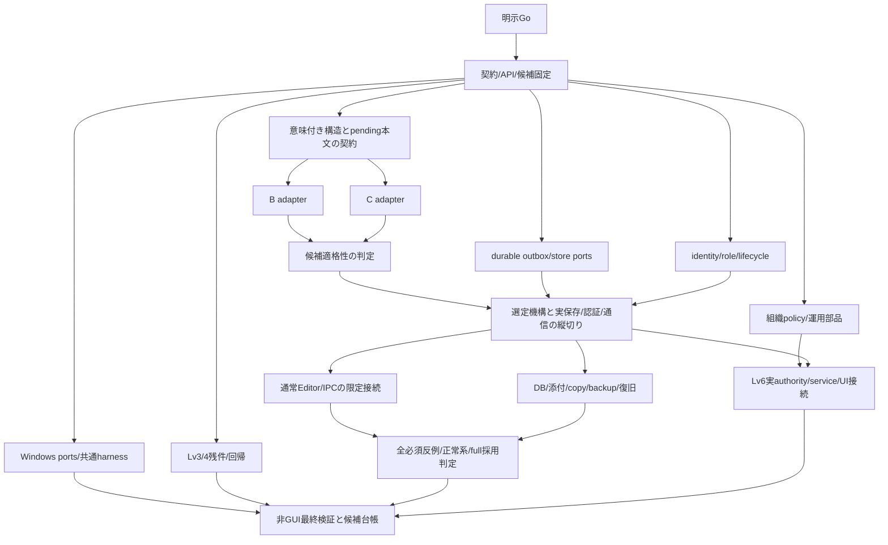

# Folio Lv3残件〜Lv6：実コード照合済み実装計画

> 実行追記: 本書は承認前の計画記録として保持する。2026-11-10に明示Goを受領し実行した。最新の実装・検証・保留は [実行結果](20261110-lv36-execution-progress.ja.md) を参照。

2026-11-10 JST。**PLAN_ONLY / 明示Goサイン待ち。Fable5.2 XHighの差分判断・生成モデルを確認済み。** 初回print経路の5.1 Fusion不一致は履歴として保持し、利用者の追加依頼による1回の相談で確認を補った。[最新の判断・採否・usage](20261110-fable52-delta-review.ja.md)を優先する。製品コード・依存・設定・workflowは変更せず、実装worker/test/build/GUI/実機通信は未着手。

この文書は実装範囲を利用者へ提示するための計画。計画報告のターンを終了してから、利用者の明示的Goサインを待つ。Go後は承認範囲の実装・本体接続・独立レビュー・非GUI検証を継続し、各waveで同じ再承認を求めない。

## 基準と調査の限界

- 統合ツリー: `<LOCAL_HOME>/Documents/ChatGPT/Folio-lv4-implementation-20261107.3qXBLqRk/integration`。
- branch: `codex/folio-lv5-collaboration-20261109`、HEAD: `522665c28747d91bb5f23f007b4037375933b893`。
- 開始時の未追跡変更: 利用者指定の `20261110-NEXT-CHAT-LV6-IMPLEMENTATION.ja.md` のみ。これを保持する。既存のworktree群を確認したが変更しない。
- 原本Notion_rea/master: `e269137f191081cabc0f05aa03ec68339ce413c2`。原本・artifacts/outputs・実データに触れない。
- 適用AGENTS.mdと指定引き継ぎ文書を全文読了。指定の最新判断・比較/PoC・lab・Lv4・Lv5全体・Lv6方向・Opus戦略4文書を確認。旧計画の限定範囲を現在の指示へ優先しない。
- processを読み取り確認。調査時に統合ツリー/旧dispatchを参照する実装processは観測しなかった。既存のDevin/OpenCode等のアプリ/processには触れない。
- 今回はsource調査と相談・計画だけ。過去PASSをfresh PASSへ更新しない。新たな確定Lv3欠陥は今回の読み取り範囲では見つかっていない。
- 調査資料と主要コード52ファイルのhashを `20261110-lv36-plan-evidence/source-audit.json` に固定する。hash一覧はソース確認であり試験結果ではない。

## 方針

privateの既存保存・復旧を維持し、shared専用のauthority/永続化/認証経路を通常のEditorへ段階的につなぐ。Lv3/4の完了済み実装は使い、未解決のR02/R03を解消し、同じ意味の合否でB/Cを再判定する。Cは優先評価候補であって全面採用済みではない。

方式の反例が残る場合は依存するfull Editorだけを保留し、outbox・認可・Windows・組織運用など独立したコードは継続する。GUI/実機が未実行であることを理由に可能なコード接続を止めず、未実装を「実機待ち」へ移さない。最終認定はLv3のまま。

## 現コードと残件の対応

| 対象 | 実コード/契約の現在地 | 今回Go後に進めるもの | 今回完了と呼べないもの |
|---|---|---|---|
| Lv3 | `docs/LEVEL3-STATUS.json` はdb7bf1aでG1〜8 PASS。private編集/保存/record/階層/添付/容量/復旧が存在 | 現候補で残件を再照合し、新たな再現欠陥だけ修正。保存/receipt、DB所有、未知raw、backup/容量、offline/navigationを回帰保護 | 古いR2残件をそのまま再開しない。新GUI/実IMEはNOT_RUN |
| Lv4 | 同期・server運用・再起動適用・競合保全・暗号化vault・cache・backup/restore・guard/watchdog実装済み | 非GUI回復/永続化の不足、移植port、H2/H3等の準備コード/観測接続、共通複数機harness。既存L4-01〜12を維持 | 実Keychain/IME/Dock/OS終了/物理Mac A/B+S、旧候補GUIの流用 |
| Lv5方式 | 実schema22node/6mark、attrs.id。B/CともR02/R03 FAIL。本文限定CのみPoC | 意味付き構造command、未送信本文anchorと移動cut、表の行/列identity、各人Undo、同一oracleで再比較 | 収束だけ、全部拒否、raw delete+insertの改名でfull採用 |
| Lv5保存 | `draft-store.ts` のraw隔離、`shared-preparation.ts` のtrusted binding、実験Cのlog/head/receipt | 実共有store、durable outbox、intent/wire/receipt対応、再起動・UNKNOWN・回収・保持/compaction | raw履歴を再送queueと呼ぶこと、fixture actorを本番認証と呼ぶこと |
| Lv5本体 | SharedEditorPortは独立部品。通常Editor/App/preload/main IPCへ未接続 | main所有shared IPC、provider、共有Editor分岐、階層/DB/添付/copy/検索/export/復旧/保存状態 | mock-onlyやlab単独を通常製品の完成とすること |
| Lv6 | labのmembership/audit/resource、copy/restore metadata案、pure UI状態のみ | 組織roleとworkspace role分離、複数領域、加入/離脱/引継ぎ、監査/容量/backup一覧、更新/復旧/再開のauthority/service/UI接続 | metadataや画面投影だけの組織運用、課金/SSO/SCIM/大規模基盤 |
| Windows | packageはdarwin/arm64固定。getuid必須、win32拒否、POSIX fsync/所有/process前提あり | Windows実装候補/port/固有suite/packagingと共通複数機手順 | Mac上のmockでWindows ACL/DPAPI/Job Objectを実証済みにすること |

根拠となる主な接続点:

- `src/editor/Editor.tsx:214,266` は通常extensions/historyと全JSON onChange。`src/renderer/App.tsx:2336` はprivateのupdateへ接続し、record本文にも別の接続点がある。
- `src/editor/block-identity.ts:36,74,138` は欠落/重複IDの乱数補修と初期化。sharedでは同じpluginを無条件に使わず、一度だけseedしたIDの整合を保証する。private挙動は維持。
- `src/main/index.ts:270` と `src/preload/index.ts:1` は既存private request入口。sender/frame確認に加え、sharedの認証済scope/sessionをmainで導出する専用入口が必要。shared raw quarantineとauthoritative commandは用途が違うため別型のまま、共通header/schemaの正規形だけを固定する。
- `src/persistence/store.ts:804` はprivate SaveOperation/receiptの単一transaction。これをshared形式へ変更しない。`src/sync/workspace-store.ts:1425` の全量置換からsharedを構造的に除外する。
- `src/main/shared-preparation.ts:33` はIPC未登録のローカルdraft service。`src/collaboration/editor-port.ts:19` はorigin/session準備port。trusted bindingは本番認証ではない。
- `experiments/collaboration-comparison/text-client.mjs:12,92,188` は再起動時unknown/draftsを空で初期化し、原文保全とreceipt-firstを行うが、durable対応/再構成はない。
- `text-authority.mjs:270` はPoC専用log/head/receiptを原子的に確定する実装。256steps等の上限とformat1002を製品能力へ一般化しない。
- 旧labの `authority.mjs` はsnapshot CAS、`outbox.mjs` は別形式、`copy.mjs`/`restore.mjs` はmetadata plan。旧blockId/strong/schemaやPM依存をそのまま製品へ持ち込まない。

## 横断契約と親の所有範囲

1. private/sharedはSQLite・assets・binding・authorityを分離する。既存private schema/fingerprint/Lv4 checkpointは維持。未知raw・unsafe整数・不正Unicode・ID・拒否intentを黙って変換/削除しない。
2. identityはorg/workspace/document/incarnation/user/device/session/epoch/generationを区別する。transport再接続で不変operationのfingerprintを書き換えない。renderer入力を認証済identityとして採用しない。
3. 保存状態は `LOCAL_DURABLE → SERVER_ACCEPTED → CLIENT_RECEIPT_DURABLE → PEER_APPLIED` と `UNKNOWN` を区別。peer未観測は未確認。local入力から最初のdurable commitまでの窓も未保存として示す。
4. serverの本文/構造/DB/role/lifecycleはshared server単一の単調commit_seqで順序付ける。workspace cutはその断面、文書PM versionは派生値とする。認可判定とrole/revoke変更・本文受理を同じSQLite transactionの序列へ入れる。log/head/receipt/auditを確定後にACK/配信。clientはintent→wire試行→receiptの永続対応を保持し、ACK不明はreceipt-first。欠落はUNKNOWN、同じbytes/identityを別IDへ作り替えない。
5. 組織失効をworkspace別DB間のbest effortへしない。初版はshared専用server SQLite内で組織controlと複数workspaceの権限/eventを扱う案を優先。workspaceは複合scopeキーで全queryを認可・隔離。別DB方式へ変える場合はcross-DB失効fence/障害回復の証明を先に追加する。
6. user/device認証を分離する。初版は外部IdP不要のself-host登録・明示bootstrap・手渡しの一回/期限/取消付き招待を想定。credentialの方式、userへの帰属確認、再登録・端末喪失時の回復をW0で固定してから担当へ渡す。試験は合成accountでも製品の認証経路を実際に通す。
7. role/失効は既存接続・subscribe・配送待ち・asset・receiptにも再適用。最後のworkspace ownerと組織管理責任者を保護。取得済データの遠隔消去は保証しない。
8. restoreは確定cutから新incarnationへ一度だけseed。旧queueを保全し自動混入しない。server旧backup復元は新epoch・全旧credential/session失効・独立watermark照合。証拠がない範囲はUNKNOWN。
9. 共通型/API/fingerprint/event順序、authority transaction coordinator、main/preload/既存App・Editorの最終接続、中央config/lock/harness/oracleは親Codexが所有。DeepSeekのhelperは親が渡すtransaction contextに参加し、独立したCOMMIT authorityを増やさない。

## 実装の順序と判断点

| 波 | 実装・接続 | 次への条件 / 保留する系列 |
|---|---|---|
| W0 現状/契約固定 | 現候補manifest、Lv3/4残件の新旧照合、V01〜15/L5-01〜14・Lv6条件対応、shared ports/auth/bootstrap/cut/Windows capability、暫定規模、所有path | 具体的API/型/helperと必須正常/反例をpacket化。Go前には着手しない |
| W1 方式再判定＋独立基盤 | block move/delete/tableを現在IDへ解決するserver command、pending本文anchor/構造cut/mapping、Undo。B/C両adapter。同時にoutbox基盤、Windows、組織policy、Lv3/4回帰、独立反例 | 実schema roundtrip・R01〜04とR05最小形（再起動後のintent→receipt再構成）/構造とpendingの候補適格性。R02/R03旧反例を負の対照に残す。両方式不合格ならfull editor系列だけ保留 |
| W2 実保存/認証の最小縦切り | shared client/server SQLite、intent/wire/receipt、再起動、real auth/user/device/role、loopback provider、失効、epoch/fence。A編集→端末commit→server受理→client receipt commit→B適用→再open | 直接DB確認と障害注入で実経路を確認。単なるfixture ACKを合格にしない。機構非依存基盤はV05前でも作れるがengine形式は候補適格性後 |
| W3 通常Editorへの接続 | shared専用extension/history/ID、typed IPC/preload/main、App scope分岐、REMOTE/LOCAL/SEED・遅延callback、navigation/generation fence、各人Undo・合成composition、保存/権限/UNKNOWN/復旧UI | 機能ごとに限定経路で縦切り検証。private保存echo/古いsession適用なし。full公開は必須保存・認可・lifecycle gate後 |
| W4 Lv5全機能 | 階層、実DB schema/record owner/content/value/delete共通cut、添付bytes/hash/公開順/GC、preview copy/ID・link・未知raw、検索/backlink/export、履歴/trash/restore/backup/compaction | R05〜14の非GUI必須条件と合法正常系。R14合成は実IME代替にしない。全14反例を満たさずfull採用へ進めない |
| W5 Lv6運用 | 組織とworkspace role、複数共有領域のauthority/service、加入/離脱/引継ぎ、監査アクセス・容量/保持/backup一覧、更新互換/旧writer拒否、失敗から復旧→再開 | policyだけでなく永続化・認可・UI操作まで接続。独立部品はW1から先行し、最後の一括統合へ溜めない |
| W6 Windows候補/最終照合 | Windows platform実装候補・共通複数機harness・OS固有suite、非GUI回帰と独立review、結果台帳と後日の最短実機手順 | Windows実行/GUI/物理機はNOT_RUN。未実装と実機待ちを別列。禁止操作なしで候補を作業branchへ保持 |

W1の「候補適格性」とfull採用は別判断。R05最小形は両方式の試験用永続adapterで先に確認し、機構中立outboxを仮定だけで決めない。前者を通した方式だけで制限付き縦切りを作り、後者は保存・認可・復旧を含む必須gateで判断する。auth等が未実装だから一切実装できないという循環依存を作らず、候補をfull採用と誤称しない。C優先は既存receipt/SQLiteと読みやすいstepの接続コストによる仮説で、Bも同条件で比較する。

## R02/R03の具体的な解決対象

- 移動は最新の論理blockを現在cutで移すcommandとする。旧snapshotのnodeをdelete/insertするだけでは不十分。移動と同時の本文が同じblockへ残ること、二人のmove・移動/削除・nested/list/table・copyの新IDを判定する。
- 移動前の未送信text offset/mark/selection/Undoを、block IDと構造cut/anchorへ対応付ける。受理済本文・未受理intent・wire試行を混ぜない。mapping不能は原文/依存suffixを保持した回復状態とし、受理済編集の消失を許さない。通常の合法move+editを全部拒否して解決としない。
- 表はrow/cellのattrs.idに加え、column論理IDと位置/削除世代をshared metadataで定義する。実schemaに無い属性をprivateへ追加しない。row追加とcolumn追加を現在の合法tableに順序実行し、新規row/column等の意図に含まれるIDはclientで一度発番してrawへ固定しserverで一意性を検査する。交差cellのように現在cutで初めて必要になる派生IDは、incarnation付きtable/row/column identityと固定node種別/slot namespaceから決定的に導出（実体化側のintent/attempt/commit_seqを混ぜない）して衝突検査し、そのmaterializationを永続化/配信する案を比較する。未確定な乱数割当をpeerごとに行わない。
- Bは構造commandとCRDT causal state/Undo/hidden pendingを整合させる。Cは構造commandとPM stepsのrebase/履歴/破棄suffixを整合させる。両方で同じfixture/intent/障害schedule/許容結果集合を使い、内部binaryの一致は要求しない。
- Undoは自分の操作の意味付き逆操作/補償として定義し、remote本文を巻き戻さない。slash/DnD/clipboard単位を保持。実clipboard/DnD/IMEは後日のGUI受入へ残す。
- 汎用の自作CRDT/OTや独自table CRDTを新規開発する計画には広げない。解けない場合は反例と未達機能を記録し、条件を下げずにNO_GOを維持する。

## Lv5・Lv6の機能と合否

| 領域 | 接続して検証する内容 |
|---|---|
| durable client | 原文intent、各wire試行、operation/fingerprint、receipt、projection watermarkを永続対応。途中crash/破損/容量/ACK不明後の再構成。回収後も未確定を無証拠で削除しない |
| server | schema/format/旧writer fence、単一writer、本文/構造/role/DB/lifecycle event cut、log/head/receipt/audit原子確定、拒否/UNKNOWNの区別 |
| identity/provider | userとdeviceの分離、永続credential/session、bootstrap/invite/role/最後のowner、live subscribe/queue/asset/receiptの失効。loopback HTTPの実入出力。実server/外部配送は使わない |
| Editor/状態 | 通常の共有経路、ID/seed/各人history、同名private/shared ID・navigation・遅延ACK拒否、remote echo防止、未保存/local/server/receipt/peer/UNKNOWNの操作契約 |
| DB/階層 | 実Folioのschema・record owner・本文・値・削除/復元の共通cut、型/旧owner/schema拒否、循環/同時移動、拒否intent回収。旧lab限定3型だけでfullとしない |
| 添付/copy | bytes/hash/size、staging→公開commit→参照、再開/容量/失効/GC、scope外asset取得拒否。copy前previewとsource cut再確認、外部private link/title漏えい防止、選択範囲/ID mapping/未知raw拒否、過去履歴は初版copy対象外 |
| search/export/history | watermark付き整合投影、同名ID境界、認可済search/backlink/export、履歴復元は現在cutに対する明示新操作。remote変更を全量snapshotで消さない |
| restore/compaction | 新incarnation seed一度、旧queue隔離、backup log/receipt/audit/asset/member/revokeの整合manifest、旧server巻戻しの既知欠落/UNKNOWN、compaction cutとsuffixの原子的公開。Y delete-onlyや未解決receiptを落とさない |
| 組織と複数workspace | org adminはworkspace本文閲覧権を自動取得しない。workspace roleはowner/editor/viewer。加入/離脱/全space失効と引継ぎ、最後のorg/space管理者保護、同ID衝突/越境要求拒否 |
| 運用/更新 | 監査の権限/秘匿、容量/保持/backup freshnessの一覧と実service、権限/容量/更新失敗→保全→復元→再登録→利用再開。旧writerを新形式へ戻す操作をrollbackと呼ばない |

Lv6初版のgate案（既存Lv4/Lv5を緩めるものではない）:

- L6-01: 複数workspaceで同名document/asset/operationも越境読書きされず、org管理と本文閲覧が分離される。
- L6-02: 招待→加入→role変更→離脱/失効→引継ぎが永続化され、全space/接続/queueへ反映。最後の責任者を失わない。
- L6-03: 管理操作/受理/拒否/復旧の監査とアクセス権、容量/保持/backup状態を実authorityから読める。
- L6-04: 上限到達でも未確定入力/receiptを失わず、保全・領域解放・復旧の操作を再開可能。容量表示だけで合格にしない。
- L6-05: 組織全体backupはmembership/revocation、workspace cut vector、log/receipt、assetsの整合manifestを持ち、復元後に古い権限やwriterを復活させない。
- L6-06: 更新前後互換・旧writer拒否・更新中断/失敗からの保全/再開を、合成accountと実SQLite/子processで再現。
- L6-07: 同じ候補の複数人/端末/実運用受入。今回はコード/非GUIまでで、GUI/物理機の条件はNOT_RUN。

## 暫定の規模・保持・復旧プロファイル

次は測定する合成profileの初稿で、製品能力保証や認定条件の確定値ではない。W0契約と実測で修正理由を記録する。既存private/Lv4の上限は書き換えない。

| 項目 | 初回測定候補 | 上限/期限に達した時 |
|---|---|---|
| 組織/領域/参加者 | 1組織、3 shared workspace、2〜5利用者、1人2device | scopeごとの拒否/分離と実測を確認 |
| 内容 | 1space200文書/1000records、文書2,000,000 UTF-8 bytes | 型/bytes/実DB/WAL/index増加と正常系を計測 |
| 添付 | 1件20MiB、1space100MiB | upload/publication/GC/backup余白を別計上 |
| client queue | 1000操作/20MiBを初回候補 | ACK確定/回収用余白を確保し未確定を削除しない |
| offline/receipt | 7日offline・30日receipt解決の試験候補 | 日付だけで不明receiptを消さない。超過は再認可/明示回復・原本保持 |
| backup/容量 | 3世代を初回候補。log/監査/DB/WAL/backup/一時領域の総予算はW0で別定義 | backupを作れないほど満杯にしない。未計測のディスク予約を保証しない |
| 復旧 | 受理済COMMITのprocess crash RPO0、profile内の復旧RTO30分を計測目標 | 物理停電・旧backup・全証拠喪失のRPOへ一般化しない |

同時接続数/人数、p95、offline期間を増やす場合は本文/構造/DB/添付/履歴を独立に増量する。暫定値を通すために既存の必須反例や原本保全を削らない。

## DeepSeek並列の実行方針（Go後のみ）

有料 `opencode-go/deepseek-v4.1-flash` 固定。無料版/Devin側DeepSeekへ切替えない。現CLIはOpenCode1.18.30、catalogはcontext1,000,000/output384,000、variant low/high/max。この確認はmodel一覧だけで、DeepSeekの推論は今回0回。

初回は4本程度の独立した縦切りpacketで権限・成果物・終了理由を確認し、ready仕事とprovider/CPU/RAM/親の統合余力に合わせ8→16→24を目安に拡大する。24は過去の観測でありhard limitでも固定上限でもない。独立したready作業があればさらに増やし、依存待ちを並列数のために実行しない。重いNode/buildは最大2枠。

担当別の候補・専有path・依存は [担当表](20261110-lv36-dispatch-plan.ja.md)。いずれも未投入。親がAPIを固定後、入力commit/契約版/型とhelper/source hash/専有path/正常と反例/許可操作/期限/報告先をpacketに含め、一時コピーへ配布する。同一fileの同時編集はしない。workerはshell/git/GUI/network/再委譲禁止、許可file toolのみ。依存導入・試験・統合は親が管理する。

初版成果を早期にfileへ出し、継続sessionは現CLIで成立する場合だけ使う。探索範囲を権限拡大で救わず、足りないhelper/APIをpacketへ補充する。独立reviewerへ同じ必須反例と別の攻撃的scheduleを渡し、親が差分/所有外変更/成果物/正常系/障害系を照合する。CLI exit0・モデルの完了文・テスト0件は採用根拠にしない。

出力上限はcatalogと分ける。v1.18.30のsourceには既定32,000と `min(model.limit.output, outputTokenMax)` があり、requestへ渡される。Go後、現binaryの有効設定/非秘密の送信metadataを確認し、必要なpacketだけ64k/128k候補を試す。`OPENCODE_EXPERIMENTAL_OUTPUT_TOKEN_MAX`等は現実装で有効か確認して使い、global設定を変更しない。providerが受理する実効値は今回未確認。全workerへ最大を設定しない。

cache/fresh input/text output/reasoningの数値、finish reason、length/無成果物/timeout/再投入、最大同時数、採用コード/接続済みpath/独立合格/親の手戻りを台帳へ。秘密・思考本文・巨大rawログをrepoへ入れない。quota/rate limitは記録し、課金変更や無限retryで解決しない。同じ失敗は同じpromptのまま繰り返さず、境界/API/粒度を修正する。

## Windowsの実装境界と後日の受入

| 現コードの障害 | Go後の実装候補 | Mac上で可能な確認 / 後日のWindows実測 |
|---|---|---|
| `scripts/package.mjs` darwin/arm64固定 | platform/arch別artifactとmanifest、Windows x64を第一候補、icon/path/packaged検証手順 | cross-package候補と起動確認を区別。今回package実行はなし |
| `sync-connection-vault.ts:36` getuidとinode/path identity | platformのworkspace所有/identity port、SID/DACL/handle identity | 合成contract試験まで。Windows側でowner/DACL/再parse/path変更を実測 |
| `secret-record-file.ts:180` win32拒否、`private-ledger.ts`/`m3-private-root.ts` uid/mode/sidecar前提 | Windowsのprivate root/secret record/SQLite sidecar検査、ACL継承/再parse/同名case・予約名・UNC/atomic publication | POSIX0600/0700を代用しない。未検証capabilityはfail closed |
| `durable-file.ts` とshared draftのdirectory fsync | OS別のfile flush/公開/再open境界、失敗時UNKNOWN/原本保持 | Mac mockでdurabilityを証明しない。Windowsの実filesystem障害suiteが必要 |
| `SafeStoragePort`は同期API | platform差を明記したcredential portとasync移行候補、既存暗号文/旧形式読取互換 | Electron45の同期APIは非推奨。全体upgradeをせず、移行可否は実API/互換/障害で判断 |
| POSIX watchdogの負PID/group/SIGKILL、win32拒否 | 自分が起動したprocessだけのWindows Job Object等の監督adapter | helper候補/依存/license/停止所有を調査し実装候補を作る。実Job Object/子孫回収はWindows実測 |

Windowsではまずcredential/file/owned-processの固有port gateを通し、その後に共通suiteを実行する。pathは8.3 alias、大小無区別、末尾dot/space、予約名、ADS、junction/reparse、拡張path接頭辞も検査対象。SQLite WALのnetwork filesystemを禁止し、AV等のsharing violation/rename失敗は所有fileに限る有界再試行とする。Node標準からJob Objectを直接使えるとは仮定せず、native API接続helperとそのbuild/配布の境界を記録する。Authenticode未実施もNOT_RUN。

Windows先行はMac固有の機材/GUI受入が未確認でも共通部分の証拠を集められるようにする選択で、Windows機材が利用可能と確認済みという意味ではない。実際の順序は後日の確保環境に合わせる。

必要なnative/helperの有無を隠さない。portだけ追加してWindows対応完了としない。実Windows provider/helperコードと固有suiteまで作り、MacでbuildできないWindows固有部分はBUILD_NOT_RUN、Windows実行はNOT_RUNで残す。Node/TS側のcontract・Mac回帰はGo後に確認する。

後日はWindows物理A/B＋独立serverで共通suiteを実行できるようにする。実OS/物理識別/user/device/source/artifact/harness hashを記録し、同期・共同編集・ACK/切断/失効/復元/容量を同じ意味で照合。WSL/VM/同一PC2processは物理2台ではない。今回は複数機通信・実SSH接続を行わない。

Windows証拠はplatform-neutralと定義した部分の補足に限り再利用する。既存MAC-P05/12gateを緩めず、Keychain/署名identity/実IME/Dock/Cmd+Q/picker/clipboard/物理Mac A/B+Sは別受入。実KeychainとDPAPIは同一ユーザー内の他appに対する保護が異なり、同じ保証と表示しない。

一次資料（今回読み取り確認）:

- [Electron45 safeStorage](https://github.com/electron/electron/blob/v45.0.0/docs/api/safe-storage.md): platformごとの保護、同期API非推奨/46での削除予定。
- [Node24 process.getuid](https://nodejs.org/docs/latest-v24.x/api/process.html#processgetuid): Windowsには存在しない。
- [Microsoft File Security](https://learn.microsoft.com/en-us/windows/win32/fileio/file-security-and-access-rights): security descriptor/ACLと継承。
- [Microsoft Windows path命名](https://learn.microsoft.com/en-us/windows/win32/fileio/naming-a-file) / [SQLite WAL](https://www.sqlite.org/wal.html): alias/pathの差とnetwork filesystem/複数DB原子性の制限。
- [Microsoft Job Objects](https://learn.microsoft.com/en-us/windows/win32/procthread/job-objects): 所属process群の監督/停止。どの実装を採用するかは設計判断。
- [OpenCode1.18.30 transform](https://github.com/anomalyco/opencode/blob/v1.18.30/packages/opencode/src/provider/transform.ts) / [request](https://github.com/anomalyco/opencode/blob/v1.18.30/packages/opencode/src/session/llm/request.ts): catalogと実効出力上限を分離する根拠。

## 検証・結果台帳と保留

Go後に、変更単位に見合うNode/SQLite/HTTP/PM/jsdom/所有子processの正常・障害試験を行い、最終候補で `npm run check`、`npm test -- --maxWorkers=2`、`npm run build` と対象実験suiteを実行する。heavy jobは2枠。通常VitestへGUI入口を混ぜず、既存scripts/prepost hookを確認する。`--list`を実行合格に数えない。新しいworkflow/lintを追加しない。

R01〜14を別々に、必須成功・許容拒否・禁止結果・候補hash・trace・実行種別で記録する。既存の反例再現が緑でも方式採用合格へ変換しない。独立review、private回帰、format/誤open/checkpoint、DB複合cut、添付公開/復旧、旧epoch/incarnation、失効/同ID/navigation、copy漏えい、長期offline/compactionを重点にする。

結果表の列は `コード実装 / 本体接続 / 非GUI fresh / GUI / 物理端末 / Level受入`。実装不足はUNIMPLEMENTED、依存未解決はBLOCKED、実行していない検証はNOT_RUN、既知の禁止結果はFAIL。候補commit/差分hashと実行環境を固定し、古いログをfreshへ昇格しない。今回の計画段階は全テスト/buildがNOT_RUN。

明示的に残るもの:

- 利用者のGoサイン。これを受けるまで製品変更・worker・test/buildを始めない。指定Fable5.2相談は利用者の追加依頼により生成metadataまで確認できた。詳細は差分判断記録を参照する。
- R02/R03を含む方式の本採用。Fableの賛成やCLI終了0は採用証拠ではない。
- Windows ACL/DPAPI/Job Object/packaged/native GUIと物理A/B+serverの実測。実機の台数/OS/権限/利用枠は未確認。
- Mac固有の実Keychain/IME/Dock/終了/picker等と、同じ候補の物理Mac A/B+S。以前のIMEはINFRA_BLOCKED、新候補GUIはNOT_RUN。
- 署名/公証/配布/本番user・server登録、外部IdP/配送・運用host選定、性能/人数/保持/RPO/RTOの保証。初版候補のコード/手順と実サービス運用を分ける。
- 課金、SSO/SCIM、複雑な部門/承認/ブロックACL、巨大分散書込み、mobile、無停止更新、装飾中心の磨き込みは今回対象外。
- push、workflow作成/変更/実行、master merge、デプロイ、実データ/個人Keychain操作、課金/global設定変更はGo後も禁止。

## 初回Devin CLI相談の実行記録・照合結果（履歴）

指定 `claude-fable-5-2-xhigh` は `devin models list --format json` に存在した。親はその完全一致UIDを `--model` に渡し、`--prompt-file` / `--print` / `--export` / `--permission-mode auto` で設計相談を1回実行した。新しい一時directoryに限って `--respect-workspace-trust false` を使用し、global trustや課金設定は変更しなかった。相談でのtool callは0件。編集/shell/network/再委譲を依頼していない。

**ただし指定モデルでの相談は未確認（NOT_VERIFIED_ROUTING_MISMATCH）。** exportは `Fusion (Claude Fable 5.1 XHigh + GLM-5.2 High)`、生成stepは `claude-fable-5-1-xhigh`、当該sessionの読み取り確認でも `fusion-claude-fable-5-1-xhigh-sidekick-glm-5-2` と記録されていた。CLIは3000.12.32、export agent versionは3000.12.28。不一致の原因は未確定で、表示だけの誤りとも実routingとも断定しない。モデル本人の自己申告では補わない。親がfallbackを選んだわけではないが、5.2で成立したという証拠もない。追加の重複相談/別model切替/設定変更は行っていない。

入力は重複除去済みCodex初稿と最小コード12抜粋（source path/行/hash/HEAD付き）、29,399 bytes。引き継ぎ全文・会話履歴・巨大ログは送っていない。export報告はinput41,546/completion17,813/cache read0/cache creation38,813。text/reasoning分離、cache項目の包含関係、backendの実推論回数、請求額は不明。CLI1回/記録された生成応答1件と、exportのtotal_steps11（system等を含む）を分ける。生会話とreasoningは一時領域のみ、repoには数値/モデル不一致/採否だけを保存する。[使用記録](20261110-lv36-plan-evidence/consultation-usage.json)。

下記は返ってきた設計指摘を**実コードで親が検討した結果**。指定5.2の賛成/保証とは扱わず、計画の根拠はコード/契約と後日の実検証に置く。

| 指摘 | ソース照合と採否 | 計画への反映 |
|---|---|---|
| 意味付きmoveだけではPM位置stepの消失は解決しない | 採用。R02 traceと `receiveTransaction` / `REBASE_LOST_INTENT`、旧delete+insertを確認 | W0でblock内anchor/構造cut/意味付きUndoを固定。並行delete/split/joinの決定性、期待本文/IDを字句で断定する採用試験を追加 |
| intentとattemptの二重受理防止 | 採用。ただし「現PoCが二重commitする」という確定欠陥ではない。現PoCはUNKNOWN時に停止して防いでおり、再base回復が未実装 | W0でstable intentId/intentFingerprintとattemptId/attemptFingerprintを分離、serverにもintent単位at-most-once。UNKNOWN解消前の新attemptは禁止 |
| clientID=deviceIdだと同端末複数editorを誤認 | 採用。TextClient34行/own ACK照合で確認。現通常アプリはsingle-windowで、既存private欠陥の認定ではない | editorWriterIdをdevice/auth sessionと分離。editor世代をjournalで保持し、同端末2session/遅延ACKを合成反例へ |
| 全raw envelopeを一つに統合 | 修正採用。準備draft envelopeとwire envelopeは用途が違い、無条件統一は不適切 | 新authority/outbox/IPCのtyped header/canonical形式をW0で固定。raw quarantine原文/既存formatは別型で保全 |
| step数でrole/DB共通cutは表せない | 採用。TextAuthority.versionはstep数でrole機構なし | server単調commit_seqを権威にし、workspace/doc versionは派生。認可とcommit/role/revokeを同じtransactionへ |
| IDを全てclientで作り、clientが現在頭へ再具体化して送信 | 部分採用。元のserver乱数割当ではoptimistic own-step照合に穴。一方serverを検証だけにすると同時row/columnの交差cellや競合retryが未解決 | 意図由来IDはclient一度発番、派生cellは安定identityから決定的導出＋server materialization。command受付と実行結果を区別するreceiptを定義し、元のPM own-step完全一致を無条件流用しない。両方式の実証前は設計候補 |
| Bでy-prosemirror全置換が必要になる可能性 | 懸念として採用。現在のXmlFragment/ySyncPlugin bindingは確認できるが、Yjs一般のmove不可能性までは今回未確認 | W0にBの証拠取得/再設計の停止条件。新bindingを既存Bの単純な比較と呼ばず、汎用CRDT開発へ膨張させない |
| candidate gateにも再起動/receiptが必要 | 採用 | R05最小形をW1に繰上げ。full auth/lifecycle/復旧gateとの二段階判断を維持 |
| remote originはtransaction由来、共有に乱数ID修復を入れない | 採用。Editor266行/BlockIdentity74行を確認 | shared extensionセット・tr origin・遅延callback/REMOTE echo・seed/viewer無変更を親が接続 |
| Windows固有portを共通suiteより先に検証 | 採用。uid/win32拒否/負PID/同期storageを実コードで確認。OS上の未測定事項は事実扱いしない | port単体→共通suite→Windows native/GUI/物理の順。native helper、path/共有違反、未署名、durability不足を別記 |
| 親の統合量が実効並列上限。共有projectionをprivate正本にしない | 採用。private replaceContentの全CONTENT置換を確認 | 親oracle/contract/main/App/lock所有、未統合一波超で実装投入抑制。shared正本/投影cacheをprivate CONTENTから分離 |
| receipt保持と復旧猶予、backup復元試験、quota、時計、owner device喪失、RTO起終点 | 採用 | 下記W0追加契約とL6 gateへ反映。未測定数値は保証しない |

### W0で先に固定する追加契約

- **意図と試行**: stable intent identityとその意味のfingerprintを保持し、送信試行は別のimmutable bytes/ID/hash。serverは同じscope/incarnation/intentを二重適用しない。既存intentのhash違いはID_REUSE。同一意図の受理済み別試行を見つけた時は元attemptを明示するreceiptへ解決し、違うpayloadに一致したと偽らない。新attemptは旧試行が確定不適用（例:STALEで再base可能）と証明できる場合だけ。UNKNOWNで自動再具体化/再送しない。
- **writerと現在の認証**: user/device/editorWriterId、navigation generation、現在のauth sessionと再接続を分離。旧intentのidentityを書き換えず、現在権限で再照会。auth sessionの交換だけでPMの他editor操作をown ACKへ混入させない。
- **構造結果の確認**: semantic command、serverでの決定的materialization、派生step/ID、commit cutと結果hashの対応をreceiptに含める。本文stepと構造commandの自分の確認方法を区別し、最終PM/history/Undoを同じoracleで検証する。独自Move Stepを無根拠に採用しない。
- **保持/期限**: receipt解決期間は許容offline期間＋backup復元猶予を下回らない。数値未確定でもこの不変条件を固定する。receiptのpayloadを圧縮してもintent重複防止の根拠を失わない。未解決intent/UNKNOWNは暦の期限だけで消さない。期限判定はserver時計で行い、client時計ずれを反例にする。
- **拒否/不明**: quota/role/schema等の確定拒否を一律UNKNOWNへ潰さない。commit結果を観測できない場合はUNKNOWNのまま。拒否receipt/再照会も認可し、回復draftからの明示操作は別の新intentとして扱う。
- **復旧**: backup作成だけでなくrestore/reopen/権限/旧epoch pending/R10を受入に含める。最後のownerの唯一device喪失は、運用者による本人確認済みbootstrap recoveryか、回復不能となる条件/事前backupをW0で定め、製品で黙ってownerを作り直さない。
- **RTO計測**: 初回profileでは「障害を宣言し試験用backup/回復を開始した時点」から「権限再確認済みclientの保存→peer再読込が一致する時点」までを測る。人の待機/実機移送を計測に含めるかは分けて報告。RPO0は受理済commitのprocess crash限定目標で、停電保証ではない。

### 必須反例の実装/受入対応

| 反例 | 今回の対応波/担当 | 証拠境界 |
|---|---|---|
| R01 seed/ID/viewer | W1 D01/05/06/12 | 実schemaとID、二重seed、共有乱数修復拒否 |
| R02 move/edit | W1 D01/03/04/05/06 | 両順序/分断、期待本文/IDと意図の保持、split/join/delete |
| R03 同時row/column | W1 D02/05/06 | 双方の合法追加成功・交差cell/ID/内容保持 |
| R04 自分のUndo | W1/W3 D04/12 | remote保持/操作単位。native操作は別NOT_RUN |
| R05 commit/ACK/crash | W1最小→W2 D07/08/11 | 原文/intent/attempt/receipt、専用Node障害と再open |
| R06 private checkpoint | W2/W6 親＋D29 | private/shared誤open/backup/restoreの負試験 |
| R07 DB複合cut | W4 D13 | 実record owner/schema/content/value/delete |
| R08 old incarnation | W4 D17 | restore seed一度・旧queue/遅延ACK回収 |
| R09 失効 | W2/W5 D09/10/11/20/21 | live socket/subscription/queue/asset/receipt認可 |
| R10 old server backup | W4/W5 D18 | 旧epoch/既知ACK欠落/独立証拠なしUNKNOWN |
| R11 compaction/offline/delete-only | W4 D19 | checkpoint/suffix/receipt保持と再接続 |
| R12 preview copy | W4 D14/15 | private範囲/未知raw/ID/link/asset/通信内容 |
| R13 同ID/navigation | W3/W5 D11/12/21 | same-device複数editor/session/世代/遅延ACK |
| R14 composition/remote | W3/W6 D12/24/28 | Node/jsdom合成まで。実IME/clipboard/DnDはNOT_RUN |

初回報告時は指定モデルroute不一致を未解決として終了した。その後、利用者の追加依頼で下記の差分判断を行った。製品実装のGoサインは引き続き未受領。

## 最新追記：Fable5.2 XHighの差分判断を反映

[差分判断と採否](20261110-fable52-delta-review.ja.md)が最新。sessionのfamily/thought_level/speed/ask選択と、保存されたgeneration_model=`claude-fable-5-2-xhigh`を照合し、追加の判断依頼1回・生成1件・tool0件を確認した。5.1資産は圧縮した結論/採否として再利用し、全文/思考は再送しなかった。

W0へ以下を追加する。これらの具体化と検証は利用者のGo後に行う。

1. 派生cell/初期内包blockのIDはincarnation付きtable/row/column identityと固定種別/slot namespaceから導出。実体化側のintent/attempt/commit順を混ぜない。構造metadataとPM step/headを同一transaction/cut/hashで確定し、追随/復旧は保存済み実行結果をreplayする。
2. 未適用の証明はreceipt不在では足りない。同じauthority epoch内の永続確定拒否、または照会と原子的に旧attemptを封鎖し後着を拒否する記録を必要とする。attempt拒否/無効化とintent全体の終端を区別し、serverはattemptが元intentの正当な実体化かも検証する。
3. authorityEpoch/commit_seq/prefix-chain hashを既知の同じcutと照合し、epoch宣言なしの巻戻りも停止対象にする。known ACK欠落とUNKNOWNを分ける。dedup/削除証拠はwriter/epoch fenceと復元可能なbackup証拠を考慮して保持/圧縮し、無制限の永久logや根拠なしの削除を採用しない。
4. W1出口はR01〜04＋両方式のR05最小形。旧R02/R03反例、新案正常系、未実行を別記。両候補不適格ならfull Editorだけを保留し、独立系列を継続する。排他編集へ黙って置換しない。
5. oracle/契約変更は理由/版/影響/依存成果の無効化と再検証を記録し、親も必須合否を緩めない。Go後の承認範囲内の具体化/修正に毎回の再承認は追加しない。Windowsの未build/OS未実行は分け、Mac回帰を守る。

Fableの判断は「追加条件をW0に入れればGo承認にかけられる計画」。方式採用/Level認定ではない。入力報告は41,546→20,821 tokensへ減ったが、出力は41,275、総量は62,096で前回59,359を上回った。請求額/本文と思考の内訳は不明で、総usage節約とは呼ばない。

**今回は計画と相談結果のみ。実装worker/test/build/GUIは未着手。利用者へ報告して終了し、明示Goサインを待つ。**
