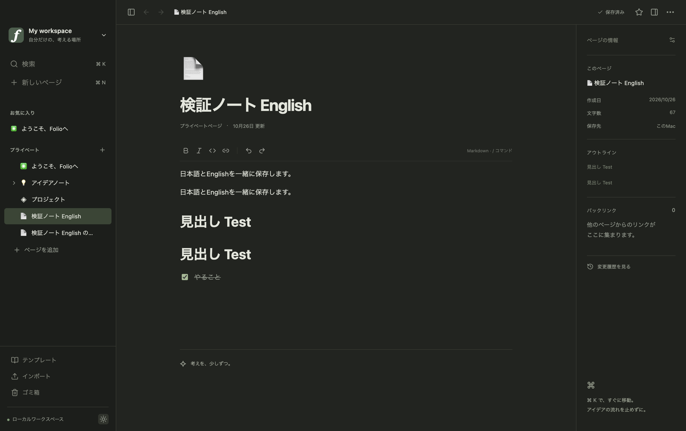
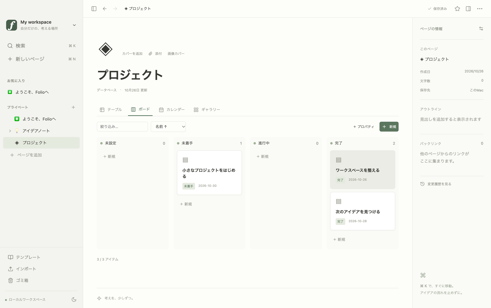

# 主要画面

2026-10-26の実Electron Playwrightテストで取得した画像を無加工でコピーしました。Notionの画面・実ユーザーデータは含めず、Folioの独自サンプルとテスト入力のみです。3画像を目視確認し、[manifest](manifest.json) に元ファイル名とSHA-256を保存しています。

## ページ編集・3カラム・Light

## 日英混在の編集・Dark

複製とUndo/Redoを試験した後の状態なので、同じ見出しと段落が2つあります。

## データベース・Board

カードをドラッグした後の状態です。再取得は `npm run build` の後に `npm run test:e2e`。出力先は `output/playwright/` です。新しい画面は目視確認後に共有用へコピーし、manifestとバイナリ検査のhashを更新してください。
